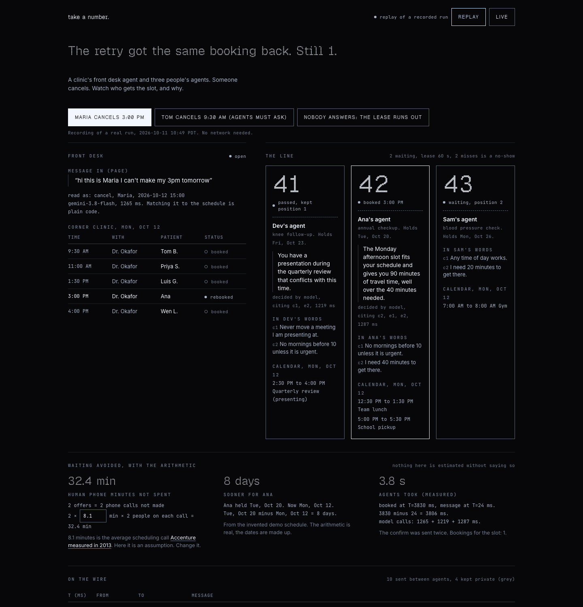
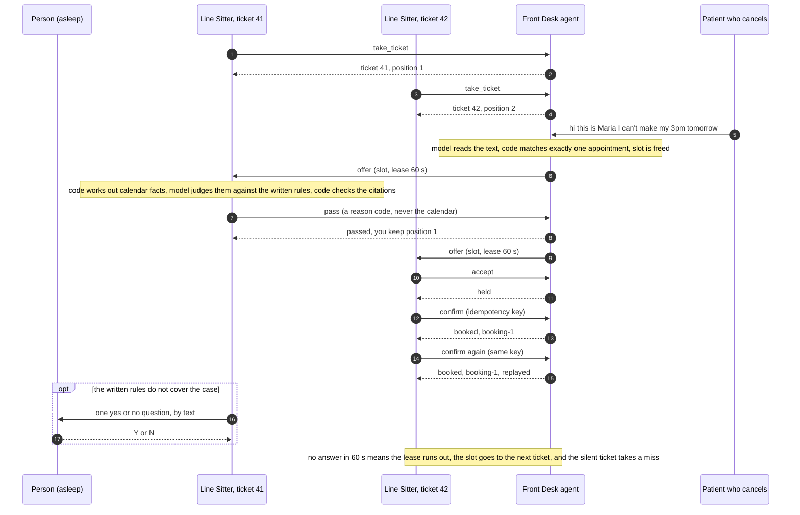

# Take a Number

When someone cancels an appointment, your helper is already standing in line holding your paper ticket, so the open spot goes to the next person waiting and not to whoever happened to be staring at the booking page.

For engineers: it is a work queue with visibility timeouts and idempotent commits, where the workers are people's agents and the message is a freed appointment slot, spoken as JSON over HTTP between agents that each publish an agent card.

**Demo page (replay of a real run, no backend needed):** https://carlkho-minerva.github.io/take-a-number/



## Story

*Written by Carl's AI agent, not by Carl. He let me take over the README for one section, the way a partner might take over a newsletter to say what the author would not say about himself.*

On September 28 Carl asked his agent to pick volunteer shifts for a conference. The agent recommended shifts and stopped, waiting for him to click. He went to sleep. By morning the three shifts he wanted were taken.

He wrote the rule down so that no later agent would repeat it: when he asks for a pick on his own account, take the slot, then tell him.

That is how he builds. His city's official calendar feed refreshes every 12 hours, so he built a watcher that checks the event feed every 15 minutes. Every tool he makes follows one standing rule: he captures, agents maintain, and nothing may depend on him remembering to check.

Take a Number is that rule pointed at everyone else's waiting. A slot should go to whoever is next in line, awake or not.

## The right problem

**Initial state.** Appointments are scarce and they come free at unpredictable times. In 15 large US metro areas the average wait for a new-patient physician appointment is 31 days ([AMN Healthcare, 2025 survey, 1,391 offices called](https://www.amnhealthcare.com/siteassets/amn-insights/physician/ps-2025-physician-appt-wait-times---wp-v6.pdf)). Meanwhile medical groups report that 19.95% of appointments are cancelled ([MGMA, 2024 data](https://www.mgma.com/mgma-stat/about-1-in-3-medical-groups-see-higher-no-shows-in-2026-as-patients-face-higher-costs)). So earlier slots do open up, all the time. The people who want them find out by calling, by refreshing a page, or by a text that arrives while they are busy. The front desk finds takers by phoning down a list.

**Goal state.** A slot that comes free is used by the person who has waited longest and can really attend, within minutes of coming free, and nobody on either side spends attention watching for it.

**Obstacles.**

1. A freed slot is perishable. Tomorrow's 3:00 PM is worth nothing at 3:01 PM tomorrow.
2. The person who wants it is asleep, driving, or in a meeting when it opens.
3. The front desk does not know who can make it. That depends on calendars and personal rules the desk should never see.
4. Letting outside software near a booking system has gone badly before. Bots took every urgent passport appointment "within minutes" in 2021 and [the State Department shut online booking down](https://www.foxla.com/news/state-department-temporarily-suspends-online-passport-booking-system-over-bots). New York [made unauthorized reservation resale illegal](https://www.governor.ny.gov/news/bon-appetit-governor-hochul-signs-legislation-cracking-down-black-market-restaurant) in 2024.
5. Messages get lost and repeated. A lost answer must not strand the slot, and a repeated one must not book it twice.
6. Not everyone will have an agent. Uptake of automated offers is already uneven: at UCSF, patients 65 and older and primarily Chinese-speaking patients were less likely to accept one ([JMIR, 2024](https://pmc.ncbi.nlm.nih.gov/articles/PMC10988365)).

**Scale.** One health system, UCSF, sent 60,660 automated offers for 21,978 freed appointments in under nine months ([same study](https://pmc.ncbi.nlm.nih.gov/articles/PMC10988365)). The same shape shows up outside medicine: US Customs says Global Entry interviews "often take weeks or even months to schedule" ([CBP, 2024](https://www.cbp.gov/newsroom/local-media-release/skip-wait-cbps-global-entry-enrollment-arrival-program-available-5)). I could not find a verified national count of freed slots that go unused, so there is no total here.

**How you would know the goal was reached.** Five numbers, measured before and after at one real front desk:

- share of cancelled slots that are rebooked before they start (the baseline to beat is in the Evidence section);
- minutes from cancellation to rebooking;
- days sooner for the person who took the slot;
- human minutes spent per rebooked slot, staff and patient added together;
- share of rebooked slots that went to the earliest ticket able to attend, split by age and language, plus the count of double bookings, which must be zero.

## Breaking it down

Subproblems, each one a thing that has to be solved:

1. **Notice the slot is free.** Cancellations arrive as free text, voicemail, portal clicks.
2. **Decide who is asked first.** An order that people accept as fair.
3. **Get that person's answer in seconds, without the person.** Someone who knows their calendar and their rules has to answer for them, and has to know when it must not.
4. **Make the handoff safe.** One holder at a time, a deadline, a retry that cannot double-book, a rule for people who never answer.
5. **Keep it from being abused.** Who may take a ticket, how many, and proof that a ticket is a person and not a reseller.
6. **Get a front desk to run its half.** Connection to the scheduling system it already uses.

Constraints, which are limits on any solution and not work items:

- A person's calendar and reasons stay on the person's side.
- The business issues the tickets and can switch the whole thing off.
- The agent never states or assumes a fact about its person that the person did not write down.
- People without an agent must still be reachable (a text with one question).
- No resale. A ticket cannot be transferred.

**Why cut it this way.** I split by who holds the information. The desk knows the schedule. The person knows their life. Neither should hand theirs over, so the only things that need to cross are an offer and an answer. Two other cuts were on the table. By industry (clinic, DMV, restaurant) would have produced three copies of the same four moves. By channel (phone, text, web) would have rebuilt today's answer with new parts, since the channels are what make people wait.

**What this repo tackles.** Subproblems 2, 3 and 4: the protocol between the two agents, plus a thin version of 1. That piece is the one no existing product offers (next section), the others depend on it, and it can be proven with tests in one day. Subproblem 5 gets only a first step here (one ticket per agent, a secret per ticket). Subproblem 6 is not attempted: the schedule is made up.

**How the pieces connect.** The front desk reads the cancellation (1), the line picks the ticket (2), the offer goes to that ticket's Line Sitter under a lease (4), the sitter answers from the calendar and the written rules or asks its person one question (3), and a confirm with an idempotency key books it (4).

## What already exists (gap analysis)

The gap being measured against: an open way for a person's own agent, holding that person's calendar and rules, to keep a place in line with any business and answer a freed slot inside a short lease.

| Existing thing | What it really does well | Where it stops | Would modifying it close the gap? |
|---|---|---|---|
| **Callback on hold.** [Mindful Callback through Twilio Flex](https://www.twilio.com/docs/flex/admin-guide/integrations/virtual-hold-technologies), [Genesys Cloud callbacks](https://help.genesys.cloud/articles/about-callbacks/) | You stop holding the phone. Runs at contact-center scale. | It holds a place in a phone queue for a live human, inside one call center. No ticket you can carry, nothing about appointment slots, and you must pick up. Social Security callers who took the callback waited 1 hour 51 minutes for it in fiscal 2025 ([Nextgov on the SSA inspector general's report](https://www.nextgov.com/digital-government/2025/12/ssa-phone-wait-times-longer-publicly-reported-metrics-oig-report/410360)). | No. Adding a ticket, an outside agent endpoint and an expiring offer to a telephony feature is building this protocol. |
| **Waitlist and queue apps.** [Waitwhile](https://waitwhile.com/virtual-waitlist/), [QLess](https://www.qless.com/) | A real queue position and text updates. QLess already serves DMV offices. | Each is a closed system and the customer is a human reading a text. Mostly same-day lines, not a future appointment that frees up. | Partly. A vendor that published a ticket and offer endpoint for outside agents would cover its own customers. It would still be one vendor. |
| **Automated waitlist fill in clinics.** [Epic MyChart Fast Pass](https://pmc.ncbi.nlm.nih.gov/articles/PMC10988365), [Luma Health Smart Waitlist](https://www.lumahealth.io/platform/smart-waitlist/), [NexHealth Waitlist](https://www.nexhealth.com/features/waitlist) | The closest prior art, with measured results: UCSF patients who took a Fast Pass offer were seen a median of 14 days sooner. | Built for human speed. Fast Pass offers go out "in batches in the evening to multiple patients for a single appointment slot" with 12 hours to respond, so it is a race and a portal login. 11% of offers were accepted. Nothing consults the patient's calendar. One vendor, one health system. | Inside healthcare, plausibly yes: Epic or Luma could let a patient-authorized agent answer the offer. That depends on the vendor choosing to, and it never reaches a DMV or a restaurant. |
| **Slot watchers and scrapers.** [Appointment Scanner](https://www.appointmentscanner.com/) (Global Entry alerts, $29 for a month of alerts), [Resy Notify](https://blog.resy.com/2021/09/notify/), [Appointment Trader](https://appointmenttrader.com/) | They work today with no cooperation from the business. | Polling, then a race among everyone alerted. Appointment Scanner "does not book interview appointments for you". Resy says an alert "is not a guarantee". The business never agreed, and the resale form is now illegal in New York without the restaurant's written agreement ([bill text](https://www.nysenate.gov/legislation/bills/2023/S9365/amendment/A)). | No. The defect is the missing consent. The fix the law points at is the one used here: the business issues the ticket. |
| **Human line sitters.** [Same Ole Line Dudes](https://www.sameolelinedudes.com/), about $25 to $37.50 an hour per [Fortune, 2025](https://www.fortune.com/2025/05/18/gen-x-entrepreneur-line-sitting-business-nyc-diddy-trial-sample-sale) | Works for any physical line with no integration. Proof that people pay for a held place. | One city, physical lines, priced by the hour. Cannot stand in a booking system at 3 AM. | No. |
| **AI that phones a business for you.** [Pixel Hold for Me](https://support.google.com/phoneapp/answer/10071878?hl=en), [Google Search business calling](https://blog.google/products/search/deep-search-business-calling-google-search/) | A person-side agent that works with any business that answers a phone. | One call, to a human, then it is over. Nobody is holding a place afterward, so a slot freed an hour later is missed. Businesses can opt out. | Partly, on the person's side. It still needs a front desk counterpart that issues tickets and offers. That counterpart is the missing half. |

**Do agent standards already cover this?** I checked. The [A2A specification](https://a2a-protocol.org/latest/specification/) gives agents a way to find each other (a card at [`/.well-known/agent-card.json`](https://a2a-protocol.org/latest/topics/agent-discovery/)) and to exchange tasks. Its task states have nothing for a queue position or a time-limited offer. [schema.org's reservation statuses](https://schema.org/ReservationStatusType) include a "hold" word and no ticket or expiry. So this protocol rides on A2A-style discovery and adds the five verbs that were missing. It does not compete with A2A.

**The gap left.** Every existing piece is either inside one vendor (and human speed), or outside the business's consent (and a race). None gives a person's own agent a place in line that the business itself issued.

## Evidence

What supports the problem:

- **The wait is long and growing.** 31 days on average for a new-patient physician appointment across six specialties in 15 metro areas, up from 26 days in 2022 and 21 days in 2004 ([AMN Healthcare, 2025](https://www.amnhealthcare.com/siteassets/amn-insights/physician/ps-2025-physician-appt-wait-times---wp-v6.pdf)). Caveat from the same report: orthopedic waits fell, so the trend is not uniform, and the survey covers big cities only.
- **Slots do free up.** A 19.95% cancellation rate at single-specialty medical groups, and only 27.40% of those cancelling patients rebook within 30 days ([MGMA, 2024 data](https://www.mgma.com/mgma-stat/about-1-in-3-medical-groups-see-higher-no-shows-in-2026-as-patients-face-higher-costs)).
- **No-shows are common.** A review of 105 studies found an average no-show rate of about 23% worldwide ([Dantas et al., Health Policy, 2018](https://ideas.repec.org/a/eee/hepoli/v122y2018i4p412-421.html)).
- **Scheduling by phone is slow.** The average scheduling call took 8.1 minutes across more than 1,000 test calls to 28 hospital systems ([Accenture, calls placed 2012 to 2013](https://www.slideshare.net/AdamBurke5/accenturewhyfirstimpressionsmatterhealthcareprovidersscheduling)). Old data, and the only measured figure I found. The demo page uses it as an editable assumption and says so.
- **On hold, by a government's own count.** Social Security's 800 number answered in 15.9 minutes on average in fiscal 2025; callers who stayed on hold waited 59 minutes ([Nextgov on the inspector general's report](https://www.nextgov.com/digital-government/2025/12/ssa-phone-wait-times-longer-publicly-reported-metrics-oig-report/410360)).
- **Offering freed slots to a waitlist works.** UCSF's Fast Pass: 60,660 offers for 21,978 freed appointments, 11% of offers accepted, patients seen a median of 14 days sooner ([JMIR, 2024](https://pmc.ncbi.nlm.nih.gov/articles/PMC10988365)).

Counter-evidence, and the strongest objections:

- **"US no-shows are far below 23%."** True. The median for US medical practices was 5% in 2018 and 7% in 2019 ([MGMA](https://www.mgma.com/data/data-stories/patient-no-shows-pose-concern-amid-medical-practic)). The 23% is a worldwide average weighted toward high no-show clinics. This project does not rest on no-shows. It handles announced cancellations, which is the 19.95% number.
- **"This already exists. Epic does it."** This is the strongest objection and it is half right. Fast Pass proves that offering freed slots to a waitlist gets people seen two weeks sooner. What it also shows is the ceiling of doing it at human speed inside one portal: 89% of offers were not accepted, with a 12 hour window and a login. The bet here is that an agent that answers in two seconds and already knows the calendar does better than 11%. **That bet is untested.** Nothing in this repo measures it. It would take a real front desk and real patients.
- **"Bots near booking systems are a known harm."** Also true, with a body count: the 2021 passport shutdown, the New York law, and Resy's own data that bots and brokers no-show at four times the normal rate ([Resy](https://resy.com/join/resources/restaurant-reservation-fraud/)). The answer is in the design and is only partly built: the business issues every ticket, one ticket per agent, tickets cannot be transferred, and a ticket that stops answering is dropped after two misses. Proving a ticket belongs to a real person is not solved here.
- **"Overbooking already handles this."** Overbooking compensates for people who vanish without a word, at the cost of longer waits in the room and staff overtime ([LaGanga and Lawrence, via CU Boulder](https://www.colorado.edu/today/2008/01/07/cu-boulder-study-clinics-overbook-appointments-can-increase-efficiency)). It does nothing with a slot that someone politely gave back a day early. The two can run together.

Not found, so not claimed: how fast people answer a text offer, what share of offers expire unanswered, and how many staff minutes it takes to refill one cancelled slot.

## How it works



The verbs, all JSON over HTTP:

| Verb | Who sends it | What it does |
|---|---|---|
| `take_ticket` | Line Sitter to desk | Joins the line. Returns ticket number, position, and a secret for that ticket. Asking twice returns the same ticket. |
| `position` | Line Sitter to desk | How many are ahead. |
| `offer` | Desk to the first ticket | A freed slot and a lease in seconds. Nobody else is asked while the lease runs. |
| `accept` | Line Sitter to desk | Holds the slot. Refused with `lease_expired` if it arrives late. |
| `pass` | Line Sitter to desk | Sends the slot to the next ticket. The passer keeps their place for every later slot and takes no penalty. |
| `confirm` | Line Sitter to desk | Books the held slot. Carries an idempotency key; the same key again returns the same booking. |

Each agent publishes a card at `/.well-known/agent-card.json` (the current A2A path) and at `/.well-known/agent.json` (the older one).

**Where the model is used, and where it is not.** Two places need language: reading the cancellation, and judging an offer against rules a person wrote in their own words ("no mornings before 10 unless it is urgent"). Everything else is plain code with tests: ticket order, leases, expiry, misses, idempotency, matching the cancellation to exactly one appointment, and computing calendar overlaps.

**How the Line Sitter is kept from inventing things.** A prompt alone is not trusted. The sitter gives the model a numbered list of facts (the person's rules, calendar facts computed by code, the reason for the visit) and the model must cite the numbers it used. Code then checks three things. Every cited fact must exist, or the answer is thrown out. An "accept" over a calendar overlap is never allowed through. And if the model does not answer, the sitter never accepts by itself: a hard overlap becomes a pass, anything else becomes one yes or no question for the person. The reason sentence stays with the person. The desk is told `pass` and a reason code.

**Three passes before calling it done.**

Failure paths, each with a test in `tests/`:

| What goes wrong | What happens |
|---|---|
| Model times out reading the cancellation | Nothing is freed. The message goes to staff, on screen, with the reason. |
| Model times out judging an offer | The sitter does not accept. Overlap means pass (code can see it); otherwise it asks its person. |
| Model answers without citing a real fact | The answer is discarded and the person is asked. |
| Lease runs out while the person is thinking | Slot goes to the next ticket. The ticket takes a miss and keeps its place. Two misses is a no-show. |
| Lease runs out between accept and confirm | Confirm is refused with `lease_expired`. Nothing is booked. The next ticket can still book it. |
| Confirm sent twice, or five times | Same booking returned, marked `replayed`. One booking exists. |
| Same key used on a different offer | Refused with `idempotency_conflict`. |
| Sitter's server is unreachable | Counts as a miss, the slot moves on at once. |
| A forged offer tells a sitter to reply to some other address | Ignored. A sitter only answers the desk it took its ticket from, so its ticket secret goes nowhere else. |
| Nobody is in line, or everyone passes | The slot is reported unfilled and returns to normal booking. Everyone keeps their place. |
| Vague message ("cancel my appointment at 3") | Needs two of name, date, time, and exactly one match. Otherwise staff. |

Latency, measured on 2026-10-11 over 7 real runs on one laptop with Gemini 3.8 Flash (`scripts/latency.py`): one offer round, from the desk sending the offer to having the sitter's answer, took a median of 1.5 s (1.1 to 1.9 s). The model call was 1.49 s of that. The protocol itself, two HTTP hops and the queue, added a median of 16 ms (10 to 18 ms). Cancellation message to confirmed booking, with one pass on the way, took a median of 4.7 s (3.6 to 5.5 s). The model is the cost, so the one optimization that would matter is asking the next ticket's agent to think ahead. I left it out because it tells a second agent about a slot it has not been offered.

Memory, time and space: the line keeps tickets in a dict in arrival order, so picking the next ticket is a scan, O(n) in the number of tickets, and every other operation is O(1) by key. For a clinic's line of tens or hundreds that scan is microseconds; a line of millions would want a heap. Memory is O(tickets + offers + bookings) and nothing is evicted, so a long-running desk would need to expire old offers and idempotency keys (a day is the usual choice) and keep the line in a database, since today it lives in process memory and is lost on restart. The transcript and the JSONL event log grow by about 300 bytes per event, around 20 events per filled slot. Each model call sends about 550 tokens, estimated as characters divided by four.

## Run it

```bash
git clone https://github.com/CarlKho-Minerva/take-a-number
cd take-a-number
cp .env.example .env          # put one model key in it; GEMINI_API_KEY is tried first
uv sync
uv run pytest -q              # 49 tests, no network, under 5 seconds
uv run uvicorn take_a_number.app:app --port 8041
```

Then open http://127.0.0.1:8041 and press **Maria cancels 3:00 PM**. The page starts in LIVE mode when it can reach the agents.

REPLAY mode needs no key and no server of ours. Use the [hosted page](https://carlkho-minerva.github.io/take-a-number/), or serve the folder yourself:

```bash
python3 -m http.server -d docs 8042     # then open http://127.0.0.1:8042
```

Other commands:

```bash
uv run python scripts/record.py          # record three real runs into docs/replay.json (server must be running)
uv run python scripts/latency.py 7       # measure offer rounds against the running server
uv run python scripts/darwin_listing.py https://your-public-host   # write the Darwin listing file; submits nothing
curl -s http://127.0.0.1:8041/.well-known/agent-card.json           # the front desk's agent card
```

## What is real and what is mocked

Real:

- The line: ticket order, leases, pass, misses, no-show, idempotent confirm. Plain Python in `take_a_number/queue.py`, 25 tests on that file alone.
- The messages. The front desk and the three Line Sitters talk over real HTTP, each at its own URL with its own agent card.
- The model calls in LIVE mode: one to read the cancellation, one per offer. Gemini 3.8 Flash. Azure OpenAI is the working fallback: with Gemini switched off in a probe it answered correctly in 7.6 s, which is slow but inside the 8 s limit.
- The recording. `docs/replay.json` is three real runs saved by `scripts/record.py` and not edited. An earlier recording caught a real model hiccup (an unusable reply; the sitter asked its person, as designed). I added one retry and recorded again, so the shipped runs are clean.
- The latency numbers above, and the Darwin search shown on the page.

Mocked, or smaller than it looks:

- The clinic, its schedule, the patients, the three people in line, their calendars and their rules are invented and live in `take_a_number/scenario.py`. No real scheduling system and no real calendar is connected.
- All four agents run in one process on one machine. The HTTP is real; the distance is not.
- Identity is one random secret per ticket. There is no proof that a ticket belongs to a real person. Anyone who knows a patient's first name and appointment time can cancel it through the demo page; a real desk would match the sender's phone number first.
- The line lives in memory. Restart the server and it is gone.
- The second confirm in the demo is sent on purpose, to show the retry is safe. The page labels it.
- "Human phone minutes not spent" multiplies real counts from the run by 8.1 minutes per call, a 2013 figure used as an assumption. You can change it on the page. "Days sooner" is real subtraction on made-up dates.
- The OpenAI fallback is wired but the key I had returned a rate-limit error today, so it has never produced an answer in this project.
- Nothing here has met a real patient or a real front desk. The claim that agents would raise acceptance above what Epic's tool gets is a hypothesis.

## Partner tools

Stated exactly, as of the last commit:

| Tool | Status | What it does here |
|---|---|---|
| **Dial** | **Simulated** unless `DIAL_API_KEY`, `DIAL_FROM_NUMBER` and `DEMO_TO_NUMBER` are all set. No key was available during the build, so no real text has been sent by this code. | When a Line Sitter must ask its person, it texts the one question ("Corner Clinic: Mon 9:30 AM opened up, held for 60 seconds. ... Reply Y to take it, N to pass."). An inbound webhook (`/integrations/dial/webhook`, signature checked) routes a Y or N to the waiting question and reads anything else as a message to the front desk. Written against Dial's documented API in `integrations/dial.py`; the request shape is untested against the live service. |
| **Darwin** | **Search is real. Listing is not submitted.** | The page makes one real, keyless call to Darwin's search asking for a line like this one, and shows what came back (on build day: nothing eligible). `scripts/darwin_listing.py` turns the front desk's agent card into `integrations/darwin_listing.json` and prints the two commands that would publish it. Publishing is left to a person. |
| **Keewano** | **Simulated with a JSONL file.** KeewanoDB Local had no public download or install guide on 2026-10-11. | Every protocol event is appended to an event log behind a two-method interface (`integrations/eventlog.py`), and the page answers one question from the full sequence: how long did the booked ticket wait, and why did the other one pass. A sequence database can replace the file without touching the agents. |

Alike and Sparta were not used.

## Built at

SpeedHacks (a16z speedrun), San Francisco, 2026-10-11. Theme: give people their time back. The project itself (`take_a_number/`, `integrations/`, `docs/`, `tests/`, `scripts/`) was written that day, and the commit history is the record. One exception, stated plainly: the pitch deck in `deck/` is styled with Carl's own design kit, a stylesheet and a canvas script he wrote before the event. No project code uses it. Fonts in `docs/fonts/` are Geist Pixel, Inter and JetBrains Mono under the SIL Open Font License, with license texts alongside.
